<div align="center">
  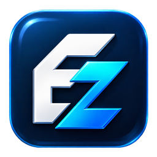
  <h1>ExcellentZip</h1>
  <p><strong>A Windows archive manager with a distinctive icon for every file type.</strong></p>
  <p>Seven icon packs. Familiar archive tools. Your choice of style.</p>
  <p>
    <a href="https://github.com/abelokoj/ExcellentZip/actions/workflows/BuildBinaries.yml"></a>
    
    
  </p>
  <p><a href="#-overview">Overview</a> · <a href="#-icon-packs">Icon packs</a> · <a href="#-downloads">Downloads</a> · <a href="#-features">Features</a> · <a href="#-setup-guide">Setup guide</a> · <a href="#-build-from-source">Build from source</a></p>
</div>

---

## 🚀 Overview

ExcellentZip brings a consistent visual identity to your archives while keeping the compression, extraction, browsing, and verification tools of a 7-Zip-based archive manager. Choose from seven icon packs; every one of the **62 registered file extensions** has its own accent color and readable format label.

**Monogram EZ, option 4, is included and is the default.** The current app version is **2026-10-27.2**. The six other packs are downloaded together from this repository after you approve the download in Settings, then remain available offline for your Windows user.

---

## 🎨 Icon packs

Each row shows one pack, with separate **App → ZIP → 7Z → RAR** icons from left to right.

<table>
<tbody>
  <tr><td><strong>1. Fluent Zip</strong></td><td>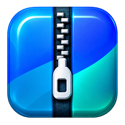</td><td>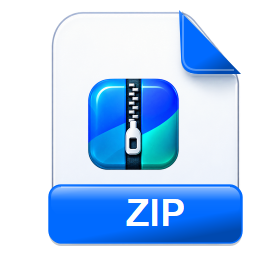</td><td>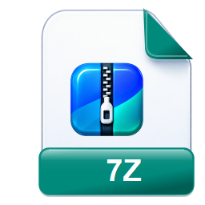</td><td>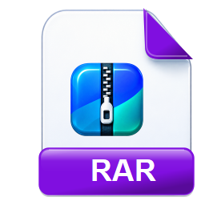</td></tr>
  <tr><td><strong>2. Outlined Pages</strong></td><td>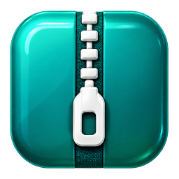</td><td>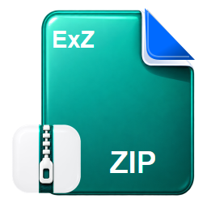</td><td>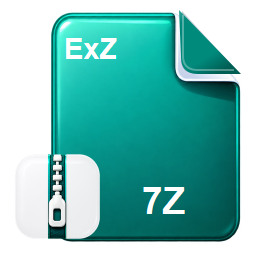</td><td>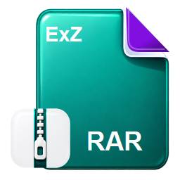</td></tr>
  <tr><td><strong>3. Golden Parcel</strong></td><td>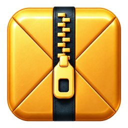</td><td>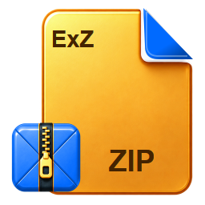</td><td>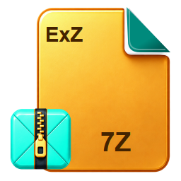</td><td>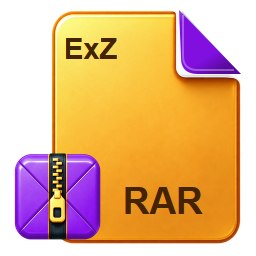</td></tr>
  <tr><td><strong>4. Monogram EZ<br/><sub><strong>Default pack</strong></sub></strong></td><td></td><td>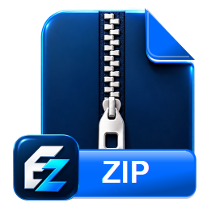</td><td>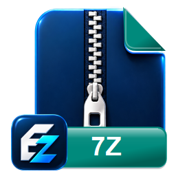</td><td>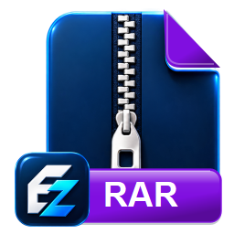</td></tr>
  <tr><td><strong>5. Prism Stack</strong></td><td>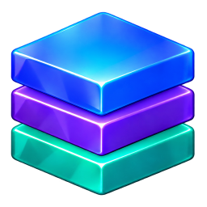</td><td>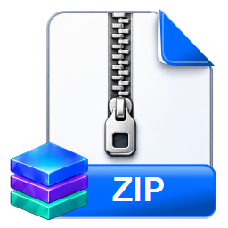</td><td>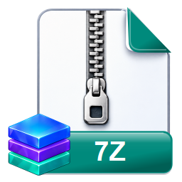</td><td>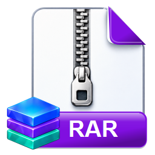</td></tr>
  <tr><td><strong>6. Archive Seal</strong></td><td></td><td>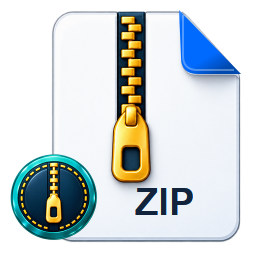</td><td>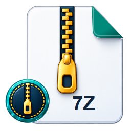</td><td>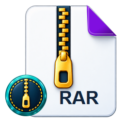</td></tr>
  <tr><td><strong>7. Color Tabs</strong></td><td>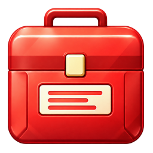</td><td>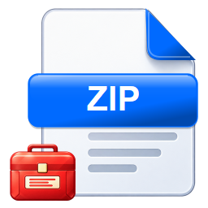</td><td>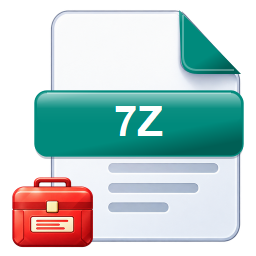</td><td>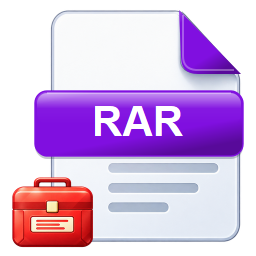</td></tr>
</tbody>
</table>

The same file type keeps its color across every pack. Download the six optional packs in Settings when you want more styles. Choose a pack in **Tools → Options → Settings → Default icon pack**, preview it, and select **Apply**.

---

## 📦 Downloads

**[Download ExcellentZip 2026-10-27.2](https://github.com/abelokoj/ExcellentZip/releases/tag/2026-10-27.2)**

- **Installer:** [`ExcellentZip-2026-10-27.2-Setup-x64.exe`](https://github.com/abelokoj/ExcellentZip/releases/download/2026-10-27.2/ExcellentZip-2026-10-27.2-Setup-x64.exe) — installs per user, adds Start-menu access, and offers file-type registration in Windows Default apps.
- **Portable:** [`ExcellentZip-2026-10-27.2-Portable-x64.zip`](https://github.com/abelokoj/ExcellentZip/releases/download/2026-10-27.2/ExcellentZip-2026-10-27.2-Portable-x64.zip) — extract the whole folder and run `ExcellentZip.exe`.
- **Checksums:** [`ExcellentZip-2026-10-27.2-SHA256.txt`](https://github.com/abelokoj/ExcellentZip/releases/download/2026-10-27.2/ExcellentZip-2026-10-27.2-SHA256.txt) — SHA-256 hashes for both downloads.

These builds target **Windows x64**, on Windows 10 version 2004 or later and Windows 11. Portable preferences are stored per Windows user. Keep the DLLs, resources, and `icons` folder together. Only Monogram EZ is bundled; optional packs are cached per Windows user after downloading.

> The downloads are unsigned. Windows may ask for confirmation before running them.

The earlier [2026-10-26.1 release](https://github.com/abelokoj/ExcellentZip/releases/tag/2026-10-26.1) remains available.

Development builds are available under **Artifacts** on successful [GitHub Actions runs](https://github.com/abelokoj/ExcellentZip/actions/workflows/BuildBinaries.yml).

---

## ✨ Features

### Archive tools

- Create ZIP and 7Z archives; browse and extract a broad range of archive, compression, and disk-image formats.
- Work with common types including ZIP, 7Z, RAR, TAR, GZ, BZ2, XZ, Zstandard, CAB, ISO, WIM, DMG, and virtual-disk images. RAR support is for extraction.
- Use password-protected archives, integrity testing, and file hashes such as SHA-256, SHA-512, and BLAKE3.
- Access additional compression codecs through the integrated archive engine.

### Windows experience

- Dark-mode support, high-DPI awareness, and a Windows-native interface.
- Smart Extraction and an option to open the destination folder after extraction.
- Mark-of-the-Web propagation during extraction.
- Graphical and command-line entry points: `ExcellentZip.exe`, `ExcellentZipG.exe`, and `ExcellentZipC.exe`.

### ExcellentZip icon system

- Monogram EZ included with the app; six optional packs available in one approved download, then usable offline.
- Distinct colors for 62 registered extensions, with labels for identification beyond color alone.
- Native icon frames at 16, 20, 24, 32, 40, 48, 64, 96, 128, and 256 pixels.
- Pack previews and selection for the application window and ExcellentZip-owned file associations.

---

## 🛠️ Setup guide

### Install

Setup can open Windows default-app confirmation for all supported types. Later, use **Tools → Options → File types** to select all, some, or individual extensions, see their current default apps, and confirm changes in Windows. Files assigned to ExcellentZip use the icon pack saved in Settings.

1. Download the x64 Setup from [Releases](https://github.com/abelokoj/ExcellentZip/releases).
2. Run the installer and choose the shortcuts and file-type registration you want.
3. Open ExcellentZip and choose an icon pack in **Tools → Options → Settings**. Approve the optional download to make the other six packs available.
4. Choose which formats ExcellentZip opens in **Windows Settings → Apps → Default apps**.

### Run portable

1. Download and extract the entire portable ZIP.
2. Run `ExcellentZip.exe` from the extracted folder.
3. Keep all accompanying files and the `icons` directory beside the app. Optional packs use a per-user cache, shared with an installed copy.

Windows can show thumbnails instead of file icons in some Explorer views. Static Start/package branding uses the default app icon; the active application window follows your selected pack.

---

## 🧰 Build from source

Install Visual Studio 2022 or later with desktop and UWP C++ tools, DesktopBridge/MSIX packaging tools, the Windows 11 SDK, and .NET SDK 9.

```powershell
./scripts/Build-Release.ps1
```

The script reads the app version from `Project/ExcellentZip.Project.Version.props` and writes the installer, portable ZIP, and checksum files into `dist`.

<details>
<summary>Checks and icon generation</summary>

```powershell
python scripts/generate_icon_download.py --check
python scripts/test_icon_assets.py
python scripts/test_packaging.py
./scripts/test_icon_runtime.cmd
```

The approved icon masters, generated assets, and provenance are in `icons`. Regeneration uses `scripts/generate_icons.py` with Pillow and CairoSVG; these are development tools, not application runtime dependencies.

See [development and release notes](Documents/ExcellentZip.md) for details.

</details>

---

## 🤝 Contributing

Bug reports, improvements, and pull requests are welcome. Read [CONTRIBUTING.md](CONTRIBUTING.md) before submitting changes. Report potential vulnerabilities through the process in [Security.md](Security.md).

App versions follow **YYYY-MM-DD.revision**, such as `2026-10-27.2`. Windows numeric version fields use the equivalent `2026.10.27.2`.

---

## 📄 License and credits

ExcellentZip builds on open-source archive technology and preserves the original authors' notices. See [License.md](License.md) and [THIRD_PARTY_NOTICES.md](THIRD_PARTY_NOTICES.md) for source attribution and the terms that apply to each component.
